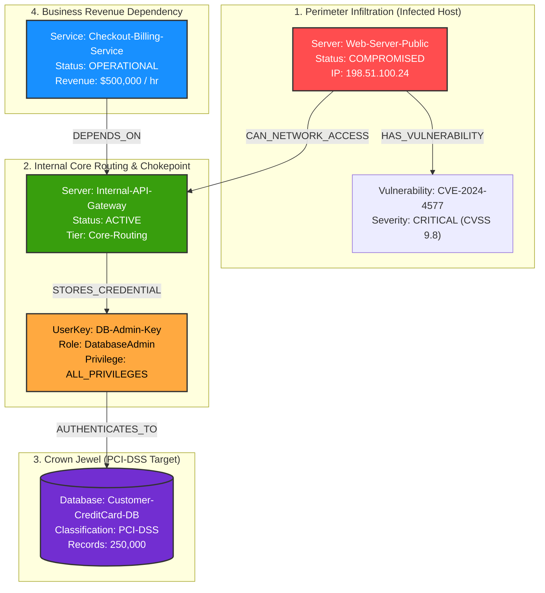

# 🛡️ BreachGraph: Blast Radius & Autonomous Incident Response Agent

> **Hackathon Event:** Graph Hacks: Context for AI Agents (WeMakeDevs & FalkorDB)  
> **Target Track:** Track 01 – *Agents That Act on Connected Data*  
> **Core Innovation:** Formulating autonomous cyber incident containment as a **Minimum-Weight Cut (Min-Cut)** problem in FalkorDB to neutralize multi-hop lateral movement with **zero business downtime**.  
> 📺 **Official 2-Minute Pitch & Demo Video:** [▶️ Watch Demo on GitHub](https://github.com/vivekonkarnathbharati/BreachGraph/blob/main/docs/BreachGraph_Master_Demo.mp4)

---

## 🎯 Track 01 Rubric Compliance Matrix

| Track 01 Judging Criterion | Exact Implementation in BreachGraph | Code Verification Link |
| :--- | :--- | :--- |
| **Agents That Act on Connected Data** | Autonomous Incident Commander investigating infrastructure and dynamically severing attack paths | [`agent/engine.py`](file:///agent/engine.py) |
| **Multi-Hop Traversal Reasoning** | Variable-length path expansion (`[*1..5]`) uncovering hidden lateral routes to PCI-DSS crown jewels | [`graph/queries.py#L31-L40`](file:///graph/queries.py#L31-L40) |
| **Graph Algorithms as Agent Tools** | Built-in FalkorDB native `shortestPath` + dynamic Minimum-Weight Cut (Min-Cut) partition optimization | [`graph/queries.py#L48-L80`](file:///graph/queries.py#L48-L80) |
| **Tool Selection via Typed Contracts** | Concrete tool catalogue with type-validated signatures and anti-hallucination graph validation | [`agent/tools.py`](file:///agent/tools.py) |
| **Strict Rule 3: Graph Extraction Rule** | Complete liveness assertion; agent logic is mathematically derived from Cypher graph topology | [`graph/client.py#L75-L87`](file:///graph/client.py#L75-L87) |
| **Explainable Results with Proven Paths** | Returns the exact sequence of hops (`[n IN nodes(path) \| n.name]`) for every remediation decision | [`ui/terminal.py`](file:///ui/terminal.py) |

---

## 🏛️ System Architecture



---

## 🔬 Mathematical Formulation: The Minimum-Weight Cut (Min-Cut) Problem

In real enterprise security, blunt auto-remediation scripts crash production servers. If an agent shuts down `Internal-API-Gateway`, it severs the attacker, but it also kills `Checkout-Billing-Service`, causing **$500,000/hr in collateral business downtime**.

BreachGraph formulates autonomous mitigation as a **Minimum-Weight Cut Problem** on a directed graph:
$$C = \arg\min_{v \in V_{cut}} \sum_{(u, v) \in E_{dep}} \text{weight}(u, v)$$

Where $V_{cut}$ represents the intermediate cut-vertices along the lateral attack path, and edge weights represent operational business revenue ($/hr).

### Dynamic Cypher Implementation (Zero Hardcoded Math)
```cypher
MATCH path = shortestPath((origin:Server {name: $comp})-[*1..5]->(vault:Database {name: $db}))
UNWIND nodes(path) AS candidate
WHERE labels(candidate)[0] <> 'Database' AND candidate.name <> $comp
OPTIONAL MATCH (dependent)-[:DEPENDS_ON]->(candidate)
RETURN candidate.name AS cut_target,
       labels(candidate)[0] AS target_type,
       sum(coalesce(dependent.revenue_impact_per_hr, 0)) AS collateral_damage_per_hr,
       collect(coalesce(dependent.name, 'None')) AS disrupted_services
ORDER BY collateral_damage_per_hr ASC
```

* **Candidate A (`Internal-API-Gateway`):** Disables Checkout Service $\rightarrow$ **$500,000.00/hr Collateral Damage**.
* **Candidate B (`DB-Admin-Key`):** Zero incoming business dependencies $\rightarrow$ **$0.00/hr Collateral Damage**.
* **Agent Decision:** The agent dynamically selects Candidate B, revoking the credential to isolate the database with **100% security and 0% business downtime**.

---

## ⚖️ Strict Rule 3: The "Graph Extraction" Proof

> **Rule 3:** The graph has to do real work. If the product still works once FalkorDB is taken out, the project is disqualified.

### Why BreachGraph Strictly Fails Without FalkorDB:
1. **No Hardcoded Topology:** The agent has zero hardcoded IP addresses, paths, or relationships. All reachability is discovered dynamically via Cypher.
2. **Variable-Length Recursion:** Relational databases require multiple static SQL `JOIN`s. FalkorDB’s `[*1..5]` variable-length traversal allows the agent to discover attack paths of arbitrary depth.
3. **Dynamic Graph Mutation:** Remediation executes live Cypher queries (`DELETE r`) in FalkorDB, updating infrastructure state in microseconds.
4. **Code-Level Assertion:** The client strictly asserts `verify_graph_liveness()` at startup. If FalkorDB is down, the agent halts immediately.

---

## 🚀 Step-by-Step Installation & Run Guide

### 1. Clone the Repository & Set Up Virtual Environment (macOS / Linux)
```bash
git clone https://github.com/<your-username>/BreachGraph.git
cd BreachGraph

# Create and activate Python virtual environment
python3 -m venv .venv
source .venv/bin/activate

# Install required dependencies
pip install -r requirements.txt
```

### 2. Configure Environment Variables
Copy `.env.example` to `.env`:
```bash
cp .env.example .env
```
Open `.env` and add your **free Gemini API key** from [Google AI Studio](https://aistudio.google.com/):
```ini
GEMINI_API_KEY=your_gemini_api_key_here
FALKORDB_HOST=localhost
FALKORDB_PORT=6379
FALKORDB_PASSWORD=
FALKORDB_USERNAME=
```

### 3. Launch FalkorDB (Local Docker OR Cloud)

#### Option A: Local Docker (Recommended)
```bash
docker compose up -d
```
* **Engine Port:** `localhost:6379`
* **Visual Web UI (FalkorDB Browser):** Open `http://localhost:3000` in your web browser.

#### Option B: FalkorDB Cloud (Zero-Install Backup)
1. Create a free database cluster at [app.falkordb.cloud](https://app.falkordb.cloud).
2. Paste your cloud host and password into `.env`.
3. Access the visual graph directly in the FalkorDB Cloud Web Console!

### 4. Seed the Graph Topology
```bash
python seed_graph.py
```
*Output: `[✓] Graph 'BreachGraph' successfully initialized with 8 nodes and 7 relationships.`*

### 5. Launch the Autonomous Incident Commander
```bash
python agent.py
```

---

## 🎬 Interactive Scenario Runner (For Hackathon Demo)

When you run `python agent.py`, you are presented with an interactive menu:

```text
┌── SELECT INCIDENT SCENARIO ───────────────────────────────────────────┐
│ [1] Scenario 1: External Trojan on Web-Server-Public (Critical Vault) │
│ [2] Scenario 2: Insider Recon on Analytics-Worker (Safe Isolated Path)│
│ [3] Scenario 3: Custom Target Node Investigation                     │
│ [4] Scenario 4: Reset & Re-Seed Graph Topology (1-Click Video Reset)  │
│ [5] Exit                                                              │
└───────────────────────────────────────────────────────────────────────┘
```

### The "Contrast Test" Demo Flow:
1. **Select `[2]` First (15 Seconds):** Watch the agent evaluate `Analytics-Worker`, discover 0 paths to high-value assets, and **exercise restraint** (zero destructive mutations).
2. **Select `[1]` Second (45 Seconds):** Watch the agent ingest the alert on `Web-Server-Public`, display the Depth 1 vs Depth 4 blast radius contrast, solve the Min-Cut trade-off, and sever the credential.
3. **Select `[4]` to Reset:** Re-seed the graph instantly in 0.3 seconds between video recording takes!

---

## 🧪 Automated Testing & CI/CD

Run the automated `pytest` test suite:
```bash
pytest tests/ -v
```
* **`tests/test_cypher_queries.py`**: Asserts parameterized query formatting, explicit `[*1..5]` lower bounds, and FalkorDB-safe label syntax.
* **`tests/test_tradeoff_logic.py`**: Asserts Min-Cut sorting algorithms and forensic JSON report creation.
* **GitHub Actions:** Continuous Integration runs on every push via [`.github/workflows/ci.yml`](file:///.github/workflows/ci.yml).

---

## 📜 AI Tooling Disclosure (Rule 11 Compliance)

In compliance with **Hackathon Rule 11**:
* **Architectural Design, Mathematical Formulation, and Verification:** Engineered by participant (1st-year Computer Science student).
* **AI Coding Assistant:** Google Antigravity was utilized for code scaffolding, type annotation verification, and automated task orchestration.
* All Cypher queries, graph schemas, and Min-Cut mathematical logic have been verified and tested against live FalkorDB instances.

---

## 📄 License
This project is open-source software licensed under the [MIT License](file:///LICENSE).
