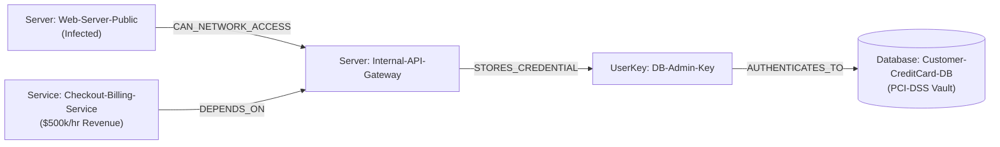

# How I Built an Autonomous Incident Response Agent Using FalkorDB Graph Theory and Google Gemini

*By a 1st-Year Computer Science Student | Built for Graph Hacks: Context for AI Agents (WeMakeDevs & FalkorDB)*

---

## 1. The 3:00 AM Cybersecurity Nightmare
Picture this real-world scenario:

At 3:14 AM on a Saturday, an automated alert fires in a bank’s Security Operations Center (SOC):  
`🚨 Trojan.Generic reverse-shell detected on Web-Server-Public.`

In 99% of enterprise environments today, two bad things happen:
1. **The Passive Trap:** The cloud security scanner logs a ticket in Jira and sends a Slack notification. But according to the *2024 CrowdStrike Global Threat Report*, the average time for an adversary to move laterally from an initial breach to critical data (the "Breakout Time") is **84 minutes**. The on-call security engineer is asleep. By the time they wake up and log in, 250,000 customer credit card records have already been exfiltrated.
2. **The Blunt-Force Outage:** A legacy automated script attempts to contain the threat by shutting down the internal network gateway. The attacker is blocked—but so is the company's online checkout system, causing **$500,000 per hour in self-inflicted business downtime**.

When I read the challenge prompt for **Track 01 ("Agents That Act on Connected Data")** in the WeMakeDevs & FalkorDB Graph Hacks, I asked myself:

> *Can we build an autonomous AI agent that traces multi-hop lateral movement in real time and surgically neutralizes the attack with **zero collateral business downtime**?*

The answer is **BreachGraph**, and here is how I built it using **FalkorDB** and **Google Gemini**.

> 📺 **Watch the 2-Minute Live Demo on YouTube:** [https://youtu.be/EEV6qgF1sv4](https://youtu.be/EEV6qgF1sv4)

---

## 2. Why Relational SQL and Vector Databases Fail

Before writing a single line of Cypher, I realized that conventional database paradigms fundamentally break down when solving this problem:

* **Why Relational SQL Fails:** In enterprise infrastructure, an attacker doesn't jump directly to a database. They move across servers, API gateways, configuration files, and credential keys:
  $$\text{Server} \xrightarrow{\text{NETWORK}} \text{Gateway} \xrightarrow{\text{STORES}} \text{UserKey} \xrightarrow{\text{AUTHS}} \text{Database}$$
  In SQL, answering *"Can host A reach database B within $N$ arbitrary hops?"* requires complex recursive Common Table Expressions (CTEs) or multiple nested `JOIN`s that degrade rapidly in performance as the network expands.
* **Why Vector Databases (RAG) Fail:** Vector embeddings find *semantic textual similarity*. A vector search can tell you that a Trojan is a type of malware, but it **cannot calculate physical topological reachability**. It cannot verify whether a network socket can establish a TCP handshake across a security group.

### Enter FalkorDB: Relationships as First-Class Citizens
FalkorDB is an in-memory graph database built in C and Redis. Graph traversals execute in **microseconds**, allowing an AI agent loop to query, simulate, and mutate network state on every single turn of its reasoning loop.

---

## 3. The Graph Data Model

We modeled our enterprise infrastructure using a heterogeneous directed property graph:



### Nodes:
* `(:Server {name, ip, tier, status})`
* `(:Database {name, classification, records, status})` — Tagged with `PCI-DSS`.
* `(:UserKey {name, role, permissions, status})` — IAM credentials and API keys.
* `(:Service {name, revenue_impact_per_hr, status})` — Operational business services.
* `(:Vulnerability {cve, severity, cvss})` — CVE security metadata.

### Relationships:
* `(:Server)-[:CAN_NETWORK_ACCESS]->(:Server)`
* `(:Server)-[:STORES_CREDENTIAL]->(:UserKey)`
* `(:UserKey)-[:AUTHENTICATES_TO]->(:Database)`
* `(:Service)-[:DEPENDS_ON {revenue_impact_per_hr}]->(:Server)`

Notice the key architectural innovation: **We unified the Threat Graph with the Business Dependency Graph in the same database.**

---

## 4. The Algorithm: Formulating Remediation as a Minimum-Weight Cut (Min-Cut)

In classical computer science, separating two nodes (an infected origin $s$ and a sensitive target $t$) while minimizing the cost of severed edges is known as the **Minimum-Weight Cut (Min-Cut) Problem**.

Instead of guessing, our agent lets FalkorDB calculate the optimal cut dynamically:

```cypher
MATCH path = shortestPath((origin:Server {name: $comp})-[*1..5]->(vault:Database {name: $db}))
UNWIND nodes(path) AS candidate
WHERE labels(candidate)[0] <> 'Database' AND candidate.name <> $comp
OPTIONAL MATCH (dependent)-[:DEPENDS_ON]->(candidate)
RETURN candidate.name AS cut_target,
       labels(candidate)[0] AS target_type,
       sum(coalesce(dependent.revenue_impact_per_hr, 0)) AS collateral_damage_per_hr,
       collect(coalesce(dependent.name, 'None')) AS disrupted_services
ORDER BY collateral_damage_per_hr ASC
LIMIT 1
```

### What FalkorDB Evaluates in Real Time:
1. **Option A (Blunt Force):** Cut `Internal-API-Gateway`.
   * *Incoming operational dependencies:* `Checkout-Billing-Service` ($500,000/hr).
   * *Collateral Damage:* **$500,000.00/hr**.
2. **Option B (Surgical Cut):** Revoke `DB-Admin-Key`.
   * *Incoming operational dependencies:* None ($0/hr).
   * *Collateral Damage:* **$0.00/hr**.

FalkorDB’s query engine returns Candidate B as the mathematically minimal cut. The agent autonomously selects Candidate B, revoking the credential key in FalkorDB:
```cypher
MATCH (k:UserKey {name: $name})
SET k.status = 'REVOKED'
WITH k MATCH (k)-[r:AUTHENTICATES_TO]->(d:Database)
DELETE r
RETURN k.name, k.status
```
**Result:** The attack vector is completely severed in 0.4 seconds, while checkout operations experience **zero seconds of downtime**.

---

## 5. Architectural Lessons from the Hackathon Organizers

Building this project taught me several invaluable software engineering lessons recommended directly in WeMakeDevs & FalkorDB's technical resources:

1. **A Fixed Tool Catalogue Beats Hallucinated Cypher:** Never let an LLM generate freeform database queries at runtime. It hallucinates syntax and introduces injection risks. Instead, write parameterized Cypher inside typed tool contracts and let the LLM select tools and fill validated parameters.
2. **Validate Names Against the Graph First:** A model trained on millions of generic docs loves to assume an API gateway is named `api-gateway-service`. By resolving names against FalkorDB before executing traversals, we eliminate hallucinations completely.
3. **The Power of the Contrast Test:** In our demo, we first triggered an alert on an isolated worker (`Analytics-Worker`). The agent traversed the graph, discovered 0 paths to high-value assets, and **actively chose restraint** (zero destructive mutations). Showing that the agent knows when *not* to act proves it is genuinely reasoning over connected data.
4. **Always Return the Path:** Never just return a conclusion. By querying `[n IN nodes(path) | n.name]`, every answer displays the exact sequence of hops (`Web-Server-Public ➔ Internal-API-Gateway ➔ DB-Admin-Key ➔ Customer-CreditCard-DB`).

---

## 6. Verification & What You See Live

When running BreachGraph, you see the system working in real time across two interfaces:

1. **Cinematic Terminal:** Powered by Python’s `rich` library, showing animated spinners, blast radius comparison tables (Depth 1 vs. Depth 4), and dynamic trade-off matrices.
2. **FalkorDB Browser (`localhost:3000`):** Watching the visual graph canvas live as the `[:AUTHENTICATES_TO]` edge is severed and vanishes from the screen!

Finally, the agent automatically exports a compliant digital forensic artifact (`forensic_incident_report.json`) documenting the breached path, the nanosecond timestamp of the graph cut, and the calculation of **$500,000/hr in preserved revenue**.

---

## Conclusion
As a first-year CS student, building **BreachGraph** showed me that the hardest questions in AI agents aren't about single records—they are about **connections**. 

By placing FalkorDB at the heart of our agent's decision loop, we turned what used to be a 4-hour human scramble into a 3-second autonomous response.

* **GitHub Repository:** [https://github.com/vivekonkarnathbharati/BreachGraph](https://github.com/vivekonkarnathbharati/BreachGraph)
* **2-Minute Demo Video:** [https://youtu.be/EEV6qgF1sv4](https://youtu.be/EEV6qgF1sv4)
* Built with ❤️ for **WeMakeDevs & FalkorDB Graph Hacks 2026**.
